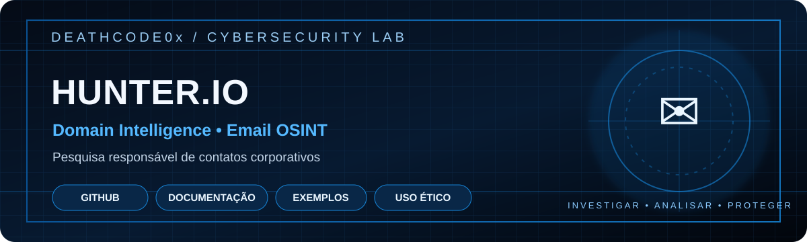

<p align="center">
  <a href="https://github.com/ArturDeathCode0x/Hunter-IO"></a>
  <a href="https://hunter.io/"></a>
  
  
</p>

> Pesquisa responsável de informações profissionais e domínios corporativos.

---

# Hunter.io

Notas de uso do Hunter para pesquisa de informações profissionais publicamente disponibilizadas e validação responsável de contatos em atividades autorizadas.

## Para que serve
- Entender a presença pública de domínios corporativos.
- Consultar informações profissionais disponibilizadas pela ferramenta.
- Apoiar inventários de exposição e processos legítimos de contato.

## Uso responsável
1. Trabalhe somente com organizações e finalidades legítimas.
2. Consulte a documentação oficial e respeite limites do plano e da API.
3. Não faça coleta em massa nem use os dados para spam, phishing ou assédio.
4. Minimize a retenção de dados pessoais e documente a finalidade.
5. Se encontrar exposição indevida, reporte ao responsável.

## API
Guarde chaves em variáveis de ambiente ou em um gerenciador de segredos. **Nunca** publique tokens, chaves ou arquivos `.env` no GitHub.

Exemplo de variável local:
```bash
export HUNTER_API_KEY="SUA_CHAVE_LOCAL"
```

Não inclua a chave real em scripts, capturas de tela ou commits.

## Referências
- Site: https://hunter.io/
- Documentação: https://hunter.io/api-documentation

## Aviso legal
Uso educacional e profissional legítimo. Cumpra a legislação de proteção de dados, os termos da plataforma e as políticas da organização.
