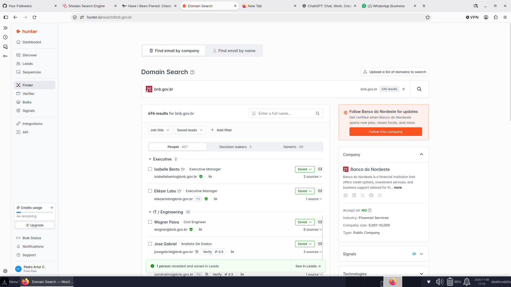

# Relatório de OSINT — Hunter.io

> Laboratório educacional de footprinting passivo, análise de exposição pública e documentação de metodologia OSINT.

## 1. Objetivo

Documentar um exercício de reconhecimento passivo utilizando o Hunter.io para observar informações profissionais associadas a um domínio corporativo e compreender os limites desse tipo de coleta.

**Domínio usado na demonstração:** bnb.gov.br  
**Ferramenta:** Hunter.io — Domain Search  
**Tipo de atividade:** consulta passiva a informações indexadas por serviço de terceiros.

## 2. Resultado observado na interface

Na captura de tela realizada durante o exercício, a interface do Hunter.io exibia **496 resultados** para o domínio consultado, distribuídos em categorias como pessoas, decisores e resultados genéricos.

Esse número representa resultados apresentados pela plataforma no momento da captura. **Não significa que 496 endereços foram confirmados, que as contas estão ativas ou que exista uma vulnerabilidade no domínio.** Os dados podem mudar conforme a indexação e os critérios do serviço.

A imagem publicada neste repositório foi reduzida e teve a área de nomes e endereços individuais ocultada para evitar a exposição desnecessária de dados pessoais.



## 3. Metodologia

1. Consultar o domínio na funcionalidade Domain Search do Hunter.io.
2. Observar os resultados agregados e os padrões públicos apresentados pela ferramenta.
3. Registrar a data, o escopo e as limitações da consulta.
4. Quando houver autorização e finalidade legítima, validar achados por fontes independentes e oficiais.
5. Minimizar a coleta e não republicar listas de contatos pessoais.

## 4. Interpretação e limitações

- A presença de um endereço em uma ferramenta OSINT não comprova comprometimento.
- Um indicador de verificação ou entregabilidade não comprova que a conta pertence a uma pessoa específica.
- Resultados de mecanismos distintos não devem ser tratados como confirmação automática uns dos outros.
- Uma ocorrência em base de vazamentos deve ser avaliada com contexto, data, origem e escopo; não se deve testar senhas nem tentar acessar contas.
- Não foi estabelecida, por este exercício, evidência suficiente para atribuir severidade ou declarar exposição confirmada de uma conta.

## 5. Automação Hunter CLI — especificação

Este repositório também registra uma proposta de interface de linha de comando em Python 3 para uso autorizado com a API oficial do Hunter.io. **O script hunter_cli.py não está incluído nesta entrega.**

Comandos planejados:

| Comando | Finalidade |
|---|---|
| setup | Configurar a chave da API localmente, sem exibi-la no terminal |
| domain | Consultar resultados de um domínio autorizado |
| find | Consultar um contato profissional específico quando houver finalidade legítima |
| verify | Consultar o status de um endereço fornecido pelo operador |
| account | Consultar informações e limites da conta da API |

### Proteção da chave

Armazene a chave em variável de ambiente ou gerenciador de segredos. Nunca faça commit de tokens, chaves ou arquivos .env.

Exemplo local:

```bash
export HUNTER_API_KEY="SUA_CHAVE_LOCAL"
```

## 6. Referências

- [Hunter.io](https://hunter.io/)
- [Documentação oficial da API](https://hunter.io/api-documentation)
- [Have I Been Pwned](https://haveibeenpwned.com/)

## 7. Aviso legal

Material para estudo educacional de OSINT e segurança da informação. Realize consultas somente em contextos legítimos e autorizados. Respeite os termos das plataformas, a legislação aplicável de proteção de dados e as políticas da organização. Não utilize os resultados para phishing, spam, assédio, tentativa de autenticação ou acesso não autorizado.
